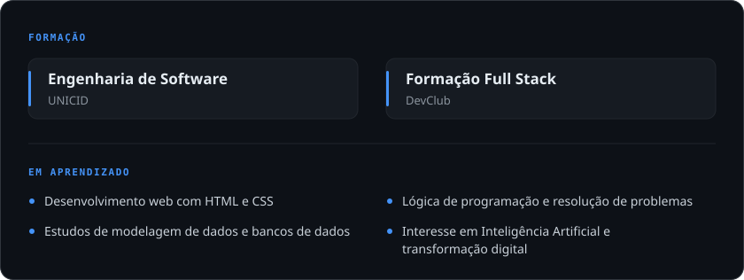
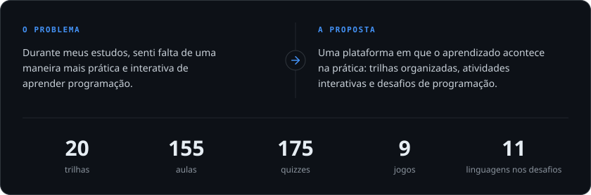
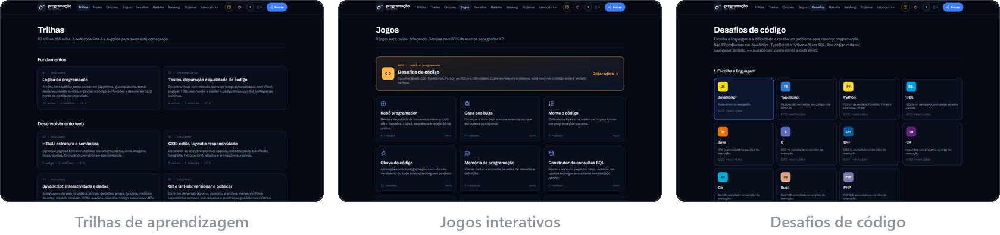
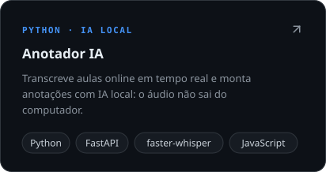
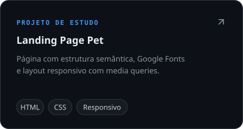
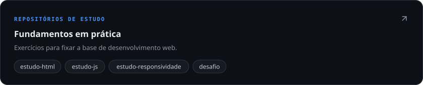
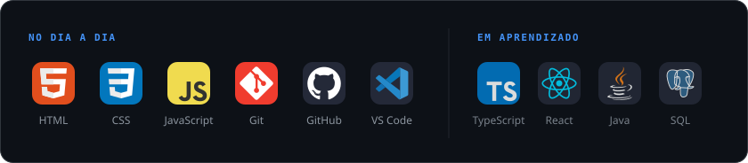

<h1 align="center">Renan Queiroz</h1>

<h3 align="center">Desenvolvedor Full Stack em formação | Engenharia de Software</h3>

  &nbsp;
  &nbsp;
  

  

 

## Sobre mim

Sou estudante de **Engenharia de Software** e minha jornada na tecnologia começou pela curiosidade de entender como as coisas funcionam e como podem ser melhoradas.

Nesse caminho, venho desenvolvendo conhecimentos em desenvolvimento web, lógica de programação, HTML, CSS, banco de dados e análise de problemas, além de me aprofundar em Inteligência Artificial (IA) e transformação digital.

Ao aprender e colocar esses conhecimentos em prática, também desenvolvi habilidades como organização, comunicação, pensamento lógico, criatividade e colaboração. Gosto de entender um problema, buscar diferentes possibilidades e transformar ideias em soluções práticas e eficientes.

Para mim, a tecnologia não se resume ao código: é uma ferramenta para resolver problemas e ajudar pessoas.

**Busco uma oportunidade** em Tecnologia da Informação (TI), Desenvolvimento de Software ou áreas relacionadas, na qual possa aplicar meus conhecimentos, adquirir experiência profissional e contribuir com a equipe. Tenho interesse em projetos que envolvam desenvolvimento, Inteligência Artificial e transformação digital, enquanto continuo aprimorando minhas habilidades.

 

## Formação e aprendizado

 

## Projeto principal

### Programação do Zero

**Do primeiro código aos seus próprios projetos.** Uma plataforma gratuita para aprender programação praticando.

  &nbsp;
  

**Como foi construído:** Next.js, React, TypeScript, Tailwind CSS e Supabase, com hospedagem gratuita no GitHub Pages. O projeto é desenvolvido com apoio de IA (*vibe coding*): eu defino o que construir, reviso, testo e decido os rumos — processo descrito de forma transparente no [repositório](https://github.com/rqstack/programacao-do-zero).

 

## Outros projetos

  
  

  

 

## Tecnologias e ferramentas

  

 

## Contribuições

  

 

## Contato

Aberto a conversar sobre oportunidades em tecnologia e desenvolvimento de software.

**E-mail:** [renan.sq.dev@gmail.com](mailto:renan.sq.dev@gmail.com) &nbsp;·&nbsp; **LinkedIn:** [linkedin.com/in/renandev07](https://www.linkedin.com/in/renandev07/)
