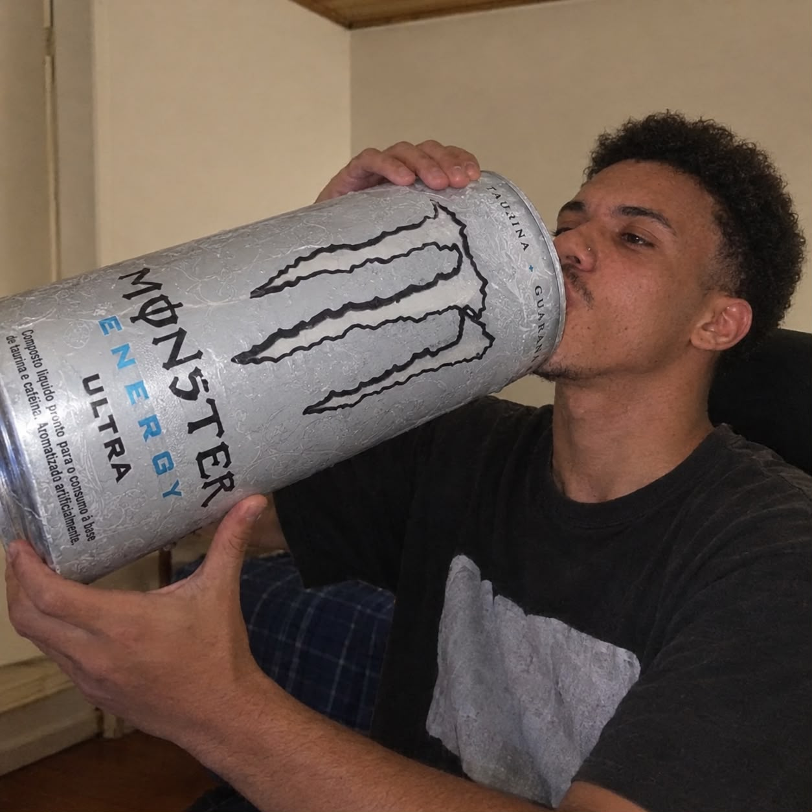

<h1 align="center"> Eu sou o Renan Queiroz 👋</h1>

<h3 align="center">Estudante de Engenharia de Software | Desenvolvedor Full Stack em formação</h3>

  

###

  
  

###

<h2 align="center">Sobre mim</h2>

  Sou estudante de Engenharia de Software e estou desenvolvendo minhas habilidades em programação Full Stack.
    
  Gosto de aprender na prática, desenvolver projetos e explorar como a programação e a inteligência artificial podem resolver problemas reais.

###

<h2 align="center">Tecnologias e ferramentas</h2>

  

###

<h2 align="center">Meus projetos</h2>

<table align="center">
  <tr>
    <td width="50%">
      <h3 align="center">Programação do Zero</h3>
      

        Projeto educacional para ajudar iniciantes a aprender programação.
      

      

        
        
      

    </td>
    <td width="50%">
      <h3 align="center">Anotador IA</h3>
      

        Projeto de aplicação com inteligência artificial para auxiliar na transcrição e organização de anotações.
      

      

        
      

    </td>
  </tr>
  <tr>
    <td width="50%">
      <h3 align="center">Projeto HTML e CSS</h3>
      

        Projeto para praticar estruturação de páginas e estilização com HTML e CSS.
      

      

        
      

    </td>
    <td width="50%">
      <h3 align="center">Estudos de HTML</h3>
      

        Repositórios com exercícios e práticas para fortalecer minha base no desenvolvimento web.
      

      

        
        
      

    </td>
  </tr>
</table>

###

<h2 align="center">Estatísticas do GitHub</h2>

  
  

###

<h2 align="center">Vamos nos conectar?</h2>

  
  

