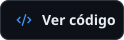
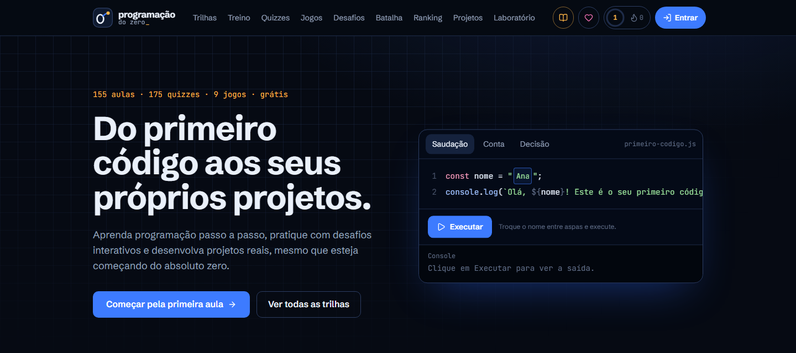
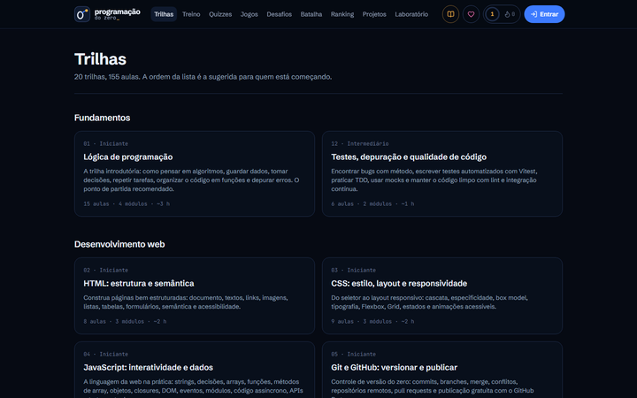
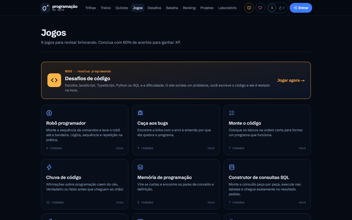
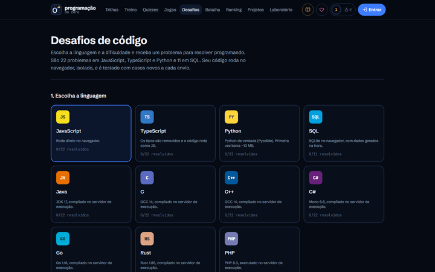

<h1 align="center">Renan Queiroz</h1>

<h3 align="center">Desenvolvedor Full Stack em formação | Engenharia de Software</h3>

  &nbsp;
  &nbsp;
  

  

 

## Sobre mim

Sou estudante de **Engenharia de Software** e minha jornada na tecnologia começou pela curiosidade de entender como as coisas funcionam e como podem ser melhoradas.

Nesse caminho, venho desenvolvendo conhecimentos em desenvolvimento web, lógica de programação, HTML, CSS, banco de dados e análise de problemas, além de me aprofundar em Inteligência Artificial (IA) e transformação digital.

Ao aprender e colocar esses conhecimentos em prática, também desenvolvi habilidades como organização, comunicação, pensamento lógico, criatividade e colaboração. Gosto de entender um problema, buscar diferentes possibilidades e transformar ideias em soluções práticas e eficientes.

Para mim, a tecnologia não se resume ao código: é uma ferramenta para resolver problemas e ajudar pessoas.

**Busco uma oportunidade** em Tecnologia da Informação (TI), Desenvolvimento de Software ou áreas relacionadas, na qual possa aplicar meus conhecimentos, adquirir experiência profissional e contribuir com a equipe. Tenho interesse em projetos que envolvam desenvolvimento, Inteligência Artificial e transformação digital, enquanto continuo aprimorando minhas habilidades.

 

## Formação e aprendizado

<table>
  <tr>
    <td width="50%" valign="top">
      <b>Formação</b>
        
      <b>Engenharia de Software</b> 
      UNICID
        
      <b>Formação Full Stack</b> 
      DevClub
    </td>
    <td width="50%" valign="top">
      <b>Em aprendizado</b>
        
      Desenvolvimento web com HTML e CSS 
      Lógica de programação e resolução de problemas 
      Estudos de modelagem de dados e bancos de dados 
      Interesse em Inteligência Artificial e transformação digital
    </td>
  </tr>
</table>

 

## Projeto principal

### Programação do Zero

**Do primeiro código aos seus próprios projetos.** Uma plataforma gratuita para aprender programação praticando.

  &nbsp;
  

<table>
  <tr>
    <td width="33%" valign="top">
      <b>O problema</b>
        
      Durante meus estudos, senti falta de uma maneira mais prática e interativa de aprender programação.
    </td>
    <td width="33%" valign="top">
      <b>A proposta</b>
        
      Uma plataforma em que o aprendizado acontece na prática: trilhas organizadas, atividades interativas e desafios de programação.
    </td>
    <td width="34%" valign="top">
      <b>O que você encontra</b>
        
      20 trilhas com 155 aulas 
      175 quizzes e 9 jogos de revisão 
      Desafios de código testados na hora 
      Laboratório e projetos guiados
    </td>
  </tr>
</table>

<table>
  <tr>
    <td width="33%" align="center">
      
       Trilhas de aprendizagem
    </td>
    <td width="33%" align="center">
      
       Jogos interativos
    </td>
    <td width="34%" align="center">
      
       Desafios de código
    </td>
  </tr>
</table>

**Como foi construído:** Next.js, React, TypeScript, Tailwind CSS e Supabase, com hospedagem gratuita no GitHub Pages. O projeto é desenvolvido com apoio de IA (*vibe coding*): eu defino o que construir, reviso, testo e decido os rumos — processo descrito de forma transparente no [repositório](https://github.com/rqstack/programacao-do-zero).

 

## Outros projetos

<table>
  <tr>
    <td width="50%" valign="top">
      <b><a href="https://github.com/rqstack/anotador-ia">Anotador IA</a></b>
        
      Transcreve aulas online em tempo real e monta anotações usando IA local: o áudio não sai do computador.
        
      Python · FastAPI · faster-whisper · JavaScript
    </td>
    <td width="50%" valign="top">
      <b><a href="https://rqstack.github.io/projeto-html-css/">Landing Page Pet</a></b>
        
      Projeto de estudo com estrutura semântica, Google Fonts e layout responsivo com media queries.
        
      HTML · CSS · <a href="https://github.com/rqstack/projeto-html-css">código</a>
    </td>
  </tr>
  <tr>
    <td colspan="2" valign="top">
      <b>Repositórios de estudo</b>
        
      Exercícios de fundamentos:
      <a href="https://github.com/rqstack/estudo-html">estudo-html</a> ·
      <a href="https://github.com/rqstack/estudo-js">estudo-js</a> ·
      <a href="https://github.com/rqstack/estudo-responsividade">estudo-responsividade</a>
    </td>
  </tr>
</table>

  

 

## Tecnologias e ferramentas

<table>
  <tr>
    <td width="50%" valign="top">
      <b>Uso nos meus projetos e estudos</b>
        
      
    </td>
    <td width="50%" valign="top">
      <b>Em aprendizado</b>
        
      TypeScript · React · Python · SQL e modelagem de dados
       
      Explorados em projetos pessoais, ainda em fase de estudo.
    </td>
  </tr>
</table>

  

 

## Contribuições

  

 

## Contato

Aberto a conversar sobre oportunidades em tecnologia e desenvolvimento de software.

**E-mail:** [renan.sq.dev@gmail.com](mailto:renan.sq.dev@gmail.com) &nbsp;·&nbsp; **LinkedIn:** [linkedin.com/in/renandev07](https://www.linkedin.com/in/renandev07/)
